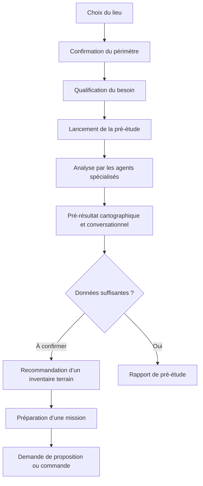

# ALi Inventaire — Fonctionnement souhaité de l’application

## 1. Vision du produit

ALi Inventaire est un assistant conversationnel spécialisé dans la pré-étude biodiversité d’un site.

Sa promesse est :

> **Comprendre le potentiel biodiversité d’un site, identifier les incertitudes et préparer la bonne expertise de terrain.**

L’application ne présente jamais ses résultats comme un inventaire écologique réel. Elle exploite les données disponibles pour produire un pré-diagnostic destiné à préparer, orienter et dimensionner une éventuelle intervention de terrain.

ALi doit toujours distinguer :

1. **Donnée connue** : observation ou information provenant d’une source identifiable.
2. **Présence potentielle** : hypothèse calculée à partir des habitats, de la répartition connue, des zonages et du contexte écologique.
3. **Présence confirmée** : présence vérifiée sur le terrain par un naturaliste.

---

## 2. Principes fondamentaux

### 2.1 Une conversation, pas un formulaire

Le panneau de gauche fonctionne comme un chatbot :

- ALi pose une question ;
- l’utilisateur répond sous le message concerné ;
- ALi confirme la réponse ;
- la conversation passe à l’étape suivante ;
- les agents spécialisés interviennent dans le même fil ;
- les résultats apparaissent comme la suite naturelle du dialogue.

Les paramètres ne doivent pas être affichés tous en même temps comme un formulaire administratif.

### 2.2 Une progression explicite

Le parcours principal est :

### 2.3 Une information scientifique traçable

Chaque conclusion doit préciser :

- sa source ;
- son niveau de preuve ;
- son périmètre géographique ;
- sa date lorsque celle-ci est disponible ;
- son niveau d’incertitude ;
- les vérifications de terrain nécessaires.

### 2.4 Aucun résultat silencieux

Si une source, un agent ou une API ne répond pas :

- l’analyse continue lorsque cela reste scientifiquement acceptable ;
- l’étape concernée est indiquée comme partielle ou indisponible ;
- la confiance globale est diminuée ;
- l’absence de réponse ne doit jamais être transformée en absence d’enjeu.

---

## 3. Structure générale de l’interface

L’écran principal contient :

- une carte interactive ;
- un panneau conversationnel fixe de 680 px sur ordinateur ;
- un panneau conversationnel plein écran sur mobile.

Le panneau comporte :

1. un en-tête encadré ;
2. un fil de conversation scrollable ;
3. les réponses et actions liées à chaque question ;
4. les activités des agents ;
5. les résultats, tableaux et preuves ;
6. les actions d’export et de poursuite du parcours.

### 3.1 En-tête

L’en-tête affiche :

- le nom **Inventaire Flash** ou **ALi Inventaire** ;
- la nature de l’assistant ;
- le lieu actuellement étudié ;
- l’action **Nouvelle conversation** ;
- l’accès à l’**Historique** ;
- l’action pour réduire le panneau.

L’en-tête est encadré par une bordure blanche afin de le distinguer du fil.

### 3.2 Style visuel

- fond noir ;
- texte blanc ;
- pictogrammes blancs ;
- police Geist ;
- taille de texte homogène de 14 px ;
- hiérarchie créée avec le poids, les espacements et les séparateurs ;
- aucune dépendance à la couleur pour comprendre une information ;
- aucun emoji dans l’interface ;
- contrôles tactiles d’au moins 44 px lorsque possible ;
- focus clavier visible ;
- animations désactivables avec `prefers-reduced-motion`.

---

## 4. Identité des intervenants

Chaque intervenant conserve un pictogramme permanent :

| Intervenant | Rôle | Pictogramme |
|---|---|---|
| ALi | Coordination et synthèse | Robot |
| Agent Occurrences | Observations disponibles | Base de données |
| Agent Zonages | Protections et périmètres | Couches cartographiques |
| Agent Potentiel écologique | Espèces et habitats potentiels | Feuille |
| Synthèse | Validation de fin d’étape | Validation |

Les agents ne discutent pas directement avec l’utilisateur comme des assistants indépendants. ALi coordonne leurs travaux et restitue leurs conclusions.

---

## 5. Parcours conversationnel complet

## Étape 1 — Définition du lieu

ALi ouvre la conversation :

> Bonjour, je suis ALi Inventaire.
>
> Je peux réaliser une première analyse de la biodiversité potentiellement présente sur votre site et identifier les vérifications à effectuer sur le terrain.
>
> Pour commencer, où se trouve le site à étudier ?

L’utilisateur peut :

- saisir une adresse ;
- saisir une commune ;
- saisir des coordonnées GPS ;
- rechercher un lieu-dit ;
- sélectionner un point sur la carte ;
- importer une emprise au format shapefile ZIP ;
- utiliser un contour disponible.

Une recherche infructueuse ne fait pas avancer le dialogue. ALi indique que le lieu n’a pas été trouvé et invite à préciser la demande.

## Étape 2 — Confirmation du périmètre

Après une localisation réussie, ALi répond :

> J’ai localisé votre site.
>
> Site : [nom du lieu]
>
> Le périmètre est-il correct ? Vous pouvez le confirmer ou le modifier directement sur la carte.

Si une emprise est disponible, ALi affiche :

- le nom de l’emprise ;
- le nombre d’entités importées ;
- le centre utilisé ;
- la surface lorsque celle-ci peut être calculée de manière fiable.

Actions :

- **Oui, ce périmètre est correct** ;
- **Modifier le périmètre** ;
- **Importer une emprise** ;
- **Choisir un autre lieu**.

Le dialogue ne doit jamais confirmer le lieu avant la fin réelle du géocodage.

## Étape 3 — Qualification du besoin

ALi demande :

> Pour adapter la pré-étude, quelle est la nature de votre projet ?

Choix possibles :

- aménagement ou construction ;
- gestion d’un site existant ;
- acquisition foncière ;
- réponse à une obligation réglementaire ;
- amélioration volontaire de la biodiversité ;
- autre projet.

ALi demande ensuite :

> À quel stade se trouve votre projet ?

Choix possibles :

- étude d’opportunité ;
- conception ;
- préparation d’une autorisation ;
- travaux prévus ;
- gestion ou suivi d’un site existant.

Ces réponses doivent servir à adapter :

- la formulation de la synthèse ;
- le niveau de prudence ;
- les vérifications recommandées ;
- l’urgence éventuelle du terrain ;
- le contenu de la proposition de mission.

Tant qu’une information n’est pas réellement utilisée par l’application, ALi ne doit pas prétendre qu’elle influence le calcul.

## Étape 4 — Définition des aires d’étude

ALi explique les périmètres proposés.

L’utilisateur peut :

- activer ou désactiver une aire ;
- ajuster son rayon ;
- appliquer un préréglage lié au type de projet ;
- revenir à une configuration personnalisée.

Chaque aire doit être nommée et accompagnée de sa distance.

La carte est mise à jour immédiatement.

## Étape 5 — Lancement de la pré-étude

ALi annonce :

> Je vais lancer une pré-étude biodiversité à partir des données disponibles.
>
> Plusieurs agents spécialisés vont analyser les observations connues, les zonages, les habitats et les espèces potentiellement présentes.
>
> Cette analyse ne remplace pas un inventaire réalisé sur le terrain par un écologue.

Action principale :

**Lancer la pré-étude biodiversité**

Le terme « pré-étude » est préféré à « inventaire » pour éviter toute confusion scientifique.

---

## 6. Analyse multi-agent

ALi lance les agents en parallèle lorsque leurs dépendances le permettent.

### 6.1 Agent Occurrences

Il consulte notamment :

- GBIF ;
- iNaturalist lorsque cette source est activée ;
- les statuts taxonomiques et réglementaires disponibles ;
- les années et nombres d’observations disponibles.

Il distingue :

- une occurrence géolocalisée ;
- un comptage agrégé ;
- une donnée documentaire ;
- une donnée ancienne ou incertaine.

Message d’activité :

> Consultation des observations disponibles dans les aires d’étude…

### 6.2 Agent Zonages

Il recherche :

- Natura 2000 ;
- ZNIEFF ;
- réserves ;
- parcs ;
- arrêtés et protections disponibles ;
- autres zonages pertinents.

Il calcule la relation spatiale entre le site, son emprise et les zonages.

Message d’activité :

> Vérification des zonages réglementaires et des espaces protégés…

### 6.3 Agent Potentiel écologique

Il croise :

- habitats connus ;
- habitats Natura 2000 ;
- espèces désignatrices ;
- répartition documentaire ;
- contexte écologique ;
- observations disponibles ;
- compatibilité espèces-habitats.

Il ne transforme jamais une compatibilité en présence avérée.

Message d’activité :

> Recherche des espèces susceptibles d’utiliser le site…

### 6.4 ALi coordinateur

ALi :

- distribue les analyses ;
- suit les erreurs ;
- consolide les taxons ;
- évite les doublons ;
- sépare données terrestres et marines ;
- évalue la confiance ;
- produit une synthèse compréhensible ;
- recommande les vérifications terrain.

---

## 7. Affichage pendant l’analyse

Le fil affiche successivement :

| Analyse | Message |
|---|---|
| Occurrences | Consultation des observations disponibles… |
| Zonages | Vérification des zonages et protections… |
| Habitats | Identification des milieux présents… |
| Potentialités | Recherche des espèces susceptibles d’utiliser le site… |
| Terrain | Évaluation des informations restant à confirmer… |

Chaque agent possède un état :

- en attente ;
- en cours ;
- terminé ;
- partiel ;
- indisponible.

L’utilisateur peut continuer à lire les étapes déjà terminées pendant que les autres agents travaillent.

---

## 8. Pré-résultat conversationnel

ALi annonce :

> La pré-étude est terminée.
>
> J’ai analysé [lieu] sur [nombre] aire(s) — [description des zones], avec les sources [sources utilisées].

ALi résume ensuite :

- les milieux identifiés ;
- les espèces observées dans le secteur ;
- les espèces à enjeu potentiellement présentes ;
- les zonages intersectés ou proches ;
- les continuités écologiques documentées ;
- les secteurs ou sujets à vérifier sur le terrain.

Les valeurs affichées proviennent obligatoirement des résultats réels. Aucun nombre d’exemple ne doit être présenté comme une donnée calculée.

---

## 9. Indicateurs de synthèse

Quatre indicateurs structurent le pré-résultat :

| Indicateur | Signification |
|---|---|
| Potentiel écologique | Niveau d’enjeu écologique potentiel du site |
| Qualité des données | Quantité, précision, récence et diversité des sources |
| Incertitude | Part du diagnostic restant à confirmer |
| Inventaire terrain conseillé | Recommandation argumentée, oui ou non |

Le potentiel écologique et la confiance sont deux notions différentes.

Un potentiel faible avec des données insuffisantes ne doit pas être présenté comme une absence d’enjeu.

---

## 10. Présentation des espèces

Chaque espèce appartient explicitement à une catégorie de preuve :

### A — Présence avérée

Observation exploitable située dans le périmètre pertinent.

### B — Présence documentée à l’échelle du site ou du zonage

Information officielle ou documentaire liée au site, sans occurrence ponctuelle exploitable.

### C — Présence très probable localement

Compatibilité forte entre l’espèce, les habitats et le contexte.

### D — Présence potentielle

Hypothèse plausible nécessitant une vérification.

### E — Faible pertinence locale

Espèce mentionnée dans les données disponibles mais peu compatible avec le contexte étudié.

Pour chaque espèce, l’interface peut afficher :

- nom scientifique ;
- nom vernaculaire ;
- groupe taxonomique ;
- niveau de preuve ;
- statut ;
- sources ;
- dernière année connue ;
- nombre d’observations ;
- habitats compatibles ;
- raisons de sa présence dans le résultat ;
- caractère exotique envahissant éventuel ;
- lien vers la source.

Une espèce exotique envahissante représente un enjeu de gestion, pas automatiquement un enjeu patrimonial.

---

## 11. Carte et résultats

La carte reste synchronisée avec la conversation :

- sélectionner une espèce dans le fil la met en évidence sur la carte ;
- sélectionner un zonage dans le fil cadre son emprise ;
- cliquer un zonage cartographique ouvre sa fiche dans le fil ;
- modifier une aire met à jour la carte ;
- changer de lieu réinitialise les anciens résultats après confirmation.

Les géométries cartographiques utilisées pour la sélection doivent être des géométries vectorielles lorsque cela est nécessaire. Une couche raster WMS ne doit pas être présentée comme directement sélectionnable.

---

## 12. Explication des incertitudes

ALi doit expliquer :

> Une espèce potentiellement présente n’est pas une espèce effectivement observée.
>
> Seule une expertise de terrain permet de confirmer sa présence actuelle, son utilisation du site et le niveau d’enjeu associé.

Lorsque le terrain est recommandé, ALi précise les raisons :

- état réel des habitats inconnu ;
- observations trop anciennes ou trop éloignées ;
- présence actuelle d’espèces à enjeu non confirmée ;
- fonctions de reproduction, repos ou alimentation inconnues ;
- pressions du projet insuffisamment décrites ;
- période d’observation défavorable ;
- données disponibles incomplètes.

---

## 13. Recommandation d’une mission terrain

Si une intervention est justifiée, ALi transforme le diagnostic en recommandation concrète :

- objectif de la visite ;
- groupes biologiques prioritaires ;
- habitats à vérifier ;
- secteurs à parcourir ;
- période conseillée ;
- durée estimée ;
- profil de naturaliste recommandé ;
- livrable attendu.

Exemple de formulation :

> D’après la pré-étude, je recommande une première intervention comprenant une visite générale du site, une cartographie des habitats et la recherche des espèces ou indices de présence prioritaires.

Actions proposées :

- **Demander une proposition** ;
- **Préciser mon besoin** ;
- **Télécharger la pré-étude** ;
- **En parler à un expert**.

Ces actions ne doivent être activées que lorsque le service correspondant existe réellement.

---

## 14. Préparation et commande d’une intervention

Avant une demande de devis ou une commande, ALi recueille progressivement :

- identité ou organisation du demandeur ;
- moyen de contact ;
- accessibilité du site ;
- période ou date souhaitée ;
- contraintes de sécurité ;
- contraintes d’accès ;
- documents disponibles ;
- objectif précis de la mission.

L’écran de synthèse présente :

- site et périmètre ;
- objectif ;
- intervention proposée ;
- durée estimée ;
- livrable ;
- période recommandée ;
- profil recherché ;
- tarif ou mention « sur devis ».

Actions possibles :

- **Commander l’intervention terrain** ;
- **Demander un devis** ;
- **Échanger avec un écologue** ;
- **Modifier la mission**.

Aucune commande ne peut être simulée. Si la transaction ou la mise en relation n’est pas disponible, l’interface doit l’indiquer explicitement.

---

## 15. Historique des conversations

Les analyses sont enregistrées localement dans IndexedDB.

Règles :

- maximum de 20 conversations ;
- titre dérivé du lieu, modifiable par l’utilisateur ;
- date de dernière mise à jour ;
- statut brouillon, en cours, partiel, terminé ou échec ;
- possibilité de restaurer, renommer ou supprimer ;
- restauration sans nouvel appel aux API scientifiques ;
- conservation des paramètres, résultats et erreurs des agents.

Une nouvelle conversation repart de la question du lieu.

---

## 16. Exports et partage

L’utilisateur peut :

- copier le rapport ;
- reformuler le rapport avec l’assistant ;
- partager le texte ;
- préparer un courriel ;
- télécharger la pré-étude lorsqu’un format téléchargeable est disponible ;
- conserver un lien de reproduction lorsque cette fonction est disponible.

Le rapport reprend :

- le lieu et le périmètre ;
- les paramètres ;
- les sources ;
- les résultats ;
- les niveaux de preuve ;
- la confiance ;
- les limites ;
- les recommandations terrain.

---

## 17. Gestion des erreurs

### Lieu introuvable

ALi reste à l’étape de localisation et demande une précision.

### Aucune aire activée

Le lancement est bloqué et ALi demande d’activer au moins une aire.

### Source indisponible

La source est signalée comme indisponible. Les autres agents peuvent continuer.

### Analyse partielle

ALi présente les résultats disponibles et explique ce qui manque.

### Analyse interrompue

L’historique conserve l’état comme partiel ou en échec. L’utilisateur peut relancer avec les mêmes paramètres.

### Changement de lieu avec résultats existants

ALi demande confirmation avant d’effacer le contexte courant.

---

## 18. Exigences d’accessibilité

- navigation complète au clavier ;
- focus visible ;
- libellés accessibles pour les boutons composés uniquement d’une icône ;
- rôles et régions sémantiques ;
- messages d’erreur annoncés ;
- contraste élevé ;
- information jamais transmise uniquement par la couleur ;
- zones tactiles suffisantes ;
- prise en charge de la réduction des animations ;
- ordre de lecture identique à l’ordre visuel.

---

## 19. Exigences de performance

- le panneau reste utilisable pendant les appels réseau ;
- les agents indépendants travaillent en parallèle ;
- les appels externes sont limités dans le temps ;
- les grands périmètres ne doivent pas bloquer l’interface ;
- les géométries détaillées sont simplifiées uniquement lorsque cela ne fausse pas l’analyse ;
- les résultats intermédiaires apparaissent dès qu’ils sont disponibles ;
- une erreur externe ne déclenche pas de boucle de requêtes ;
- les échecs temporaires ne sont pas mémorisés comme des résultats scientifiques définitifs.

---

## 20. Critères d’acceptation du parcours principal

Le fonctionnement est considéré comme conforme lorsque :

1. le premier écran contient une présentation d’ALi et une question de localisation ;
2. aucun paramètre avancé n’apparaît avant la réponse au lieu ;
3. une recherche réussie fait avancer le dialogue ;
4. une recherche échouée reste à l’étape courante ;
5. ALi confirme le lieu avant de demander la validation du périmètre ;
6. les réglages apparaissent comme une réponse à une question d’ALi ;
7. le lancement utilise le terme « pré-étude biodiversité » ;
8. les agents apparaissent dans le même fil ;
9. les résultats poursuivent la conversation ;
10. les données connues et potentielles sont visuellement et textuellement distinguées ;
11. les limites et incertitudes sont toujours visibles ;
12. la restauration d’un historique ne relance aucune API scientifique ;
13. la carte et les résultats restent synchronisés ;
14. l’interface fonctionne sur ordinateur et mobile ;
15. aucune étape ne prétend fournir une présence confirmée sans terrain.

---

## 21. Résumé fonctionnel

ALi Inventaire doit se comporter comme un écologue numérique prudent :

- il questionne avant d’analyser ;
- il confirme ce qu’il a compris ;
- il montre ce que font ses agents ;
- il cite les données disponibles ;
- il distingue les faits des hypothèses ;
- il exprime l’incertitude ;
- il recommande le terrain lorsque nécessaire ;
- il aide à transformer le pré-diagnostic en mission concrète.

L’objectif n’est pas de donner une réponse artificiellement certaine, mais de permettre à l’utilisateur de comprendre rapidement :

- ce qui est connu ;
- ce qui est probable ;
- ce qui reste à vérifier ;
- quelle action entreprendre ensuite.